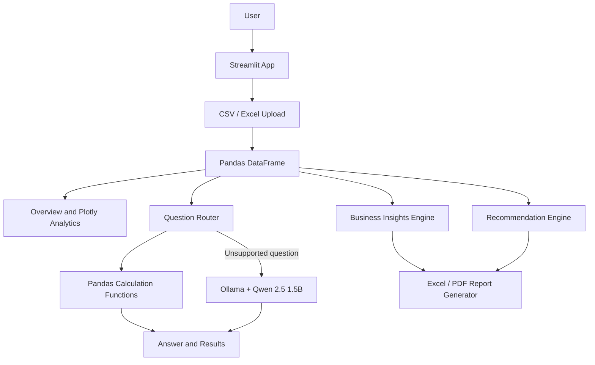

# InsightPilot AI

**A local AI-powered data analytics workspace built with Python, Pandas, Streamlit, Plotly and Ollama.**

InsightPilot AI helps users explore CSV and Excel datasets, calculate business metrics, ask natural-language questions, identify patterns, and export business reports without sending dataset content to a paid hosted LLM API.

> **Project status:** Working local MVP. The included built-in demo dataset has 10 records and 5 columns. Use your own CSV or `.xlsx` file to analyse other datasets.

## Features

- **Dataset upload:** Load CSV and Excel (`.xlsx`) files.
- **Dataset overview:** Inspect row and column counts, missing values, duplicates, data types and unique values.
- **Interactive analytics:** Build Plotly bar charts by choosing a categorical field, numeric measure and aggregation.
- **Pandas-powered question routing:** Handles supported questions such as total/average sales or profit, highest-performing product/category, top-N rankings and monthly trends.
- **Local LLM fallback:** Uses Ollama with Qwen 2.5 1.5B to answer questions that are not handled by the deterministic analytics router.
- **Automatic business insights:** Summarises sales, profit, product/category performance and potential sales outliers using the IQR method.
- **Business recommendations:** Generates rule-based recommendations from available product, category and profitability metrics.
- **Report exports:** Creates multi-sheet Excel reports and PDF business analytics reports.
- **Dataset export:** Download the active dataset as CSV.

## Technology stack

| Area | Technology |
|---|---|
| User interface | Streamlit |
| Data processing | Python, Pandas, NumPy |
| Interactive charts | Plotly Express |
| Local language model | Ollama, Qwen 2.5 1.5B |
| Excel input/output | Pandas, OpenPyXL |
| PDF reports | ReportLab |

## Architecture



### Project structure

```text
InsightPilot-AI/
├── app.py
├── requirements.txt
├── core/
│   ├── calculations.py
│   ├── insights_engine.py
│   ├── llm_engine.py
│   ├── query_router.py
│   ├── recommendation_engine.py
│   └── test_llm.py
├── reports/
│   └── report_generator.py
├── test_calculations.py
├── test_report.py
└── test_pdf_report.py
```

## Requirements

- Windows 10/11 or another environment that supports Python and Ollama.
- Python 3.11 recommended (the project was developed and tested with Python 3.11.5).
- Ollama installed and running locally.
- Enough free memory and disk space for the selected local model. A small model is used in this project to reduce resource requirements; performance depends on the computer.

## Installation (Windows PowerShell)

### 1. Extract and open the project

```powershell
cd "path\to\InsightPilot-AI"
```

### 2. Create and activate a virtual environment

```powershell
python -m venv venv
.\venv\Scripts\Activate.ps1
```

If PowerShell blocks activation, run this in the current terminal and retry:

```powershell
Set-ExecutionPolicy -Scope Process -ExecutionPolicy Bypass
.\venv\Scripts\Activate.ps1
```

### 3. Install Python dependencies

```powershell
python -m pip install --upgrade pip
pip install -r requirements.txt
```

### 4. Install Ollama and download the model

Install Ollama from [ollama.com/download](https://ollama.com/download).

Then run:

```powershell
ollama pull qwen2.5:1.5b
ollama list
```

The application uses the model name `qwen2.5:1.5b`, configured in `core/llm_engine.py`. Make sure the Ollama service is running before using the LLM fallback.

### 5. Start InsightPilot AI

```powershell
streamlit run app.py
```

Streamlit will print a local address, usually `http://localhost:8501`, which you can open in your browser.

## Example questions

The Pandas question router recognises common question patterns, depending on whether the uploaded dataset contains matching column names:

- `What is the total sales?`
- `What is the total profit?`
- `What is the average sales?`
- `Which product generated the highest sales?`
- `Which category generated the highest sales?`
- `Show the top 5 products by sales.`
- `Which month had the highest sales?`

Column matching currently recognises common names such as `sales`, `revenue`, `profit`, `product`, `category` and `date` (including selected alternatives defined in `core/query_router.py`).

## How answers are produced

InsightPilot AI prioritises deterministic Pandas calculations for supported analytical questions. This means totals, averages, rankings and monthly aggregations are calculated from the dataframe rather than asking the language model to perform arithmetic.

For questions not recognised by the router, the application sends a compact dataset context (column types, missing-value counts, numeric summary and sample rows) to the local Ollama model. The model is instructed to use the supplied context and not invent numbers.

## Reports

The **Insights & Reports** tab can generate:

- An Excel workbook with report information, KPI summary, dataset, product ranking, category ranking when a category field is available, business insights and recommendations.
- A PDF report containing dataset overview, KPIs, product/category performance, insights and recommendations.

Reports are generated from the currently active dataframe. The built-in demo dataset is only a demonstration dataset, not real company data.

## Run the included checks

From the project root, with the virtual environment activated:

```powershell
python test_calculations.py
python test_report.py
python test_pdf_report.py
```

The LLM connection test is in `core/test_llm.py`:

```powershell
python core/test_llm.py
```

Run that test only after installing Ollama, pulling the configured model and starting the Ollama service.

## Current limitations

- The question router supports a defined set of question patterns and common column names; it is not a general-purpose natural-language-to-SQL engine.
- The local LLM fallback receives a limited dataset context rather than the entire raw dataset.
- Business recommendations are rule-based suggestions, not predictions or professional business advice.
- IQR flags identify potential outliers; an outlier is not automatically an error.
- The app currently supports CSV and `.xlsx` uploads.
- Model response quality and speed depend on local hardware and available memory.

## Future enhancements

- More flexible column mapping and date detection.
- Additional analytical question types and safer query planning.
- More chart types and downloadable chart images.
- Configurable report branding and PDF charts.
- Automated tests for query routing, data-quality edge cases and report contents.
- Optional database-backed analysis for larger datasets.

## Privacy note

The application is designed for local use. Dataset calculations run in the local Python process, and the LLM integration uses the local Ollama service. Do not assume that every future integration or deployment is local; review any added external services before uploading confidential data.

## Author

**InsightPilot AI** — developed as a hands-on Data Analytics and local-LLM project.

---

If you find an issue, include the Python version, the command you ran and the full error message when reporting it.
